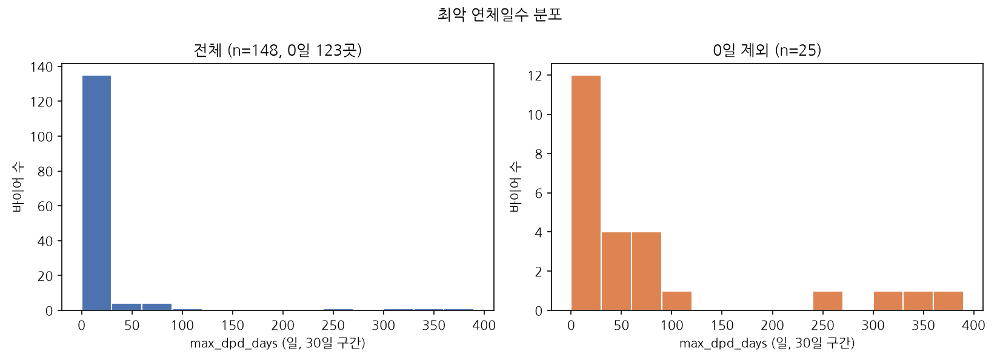
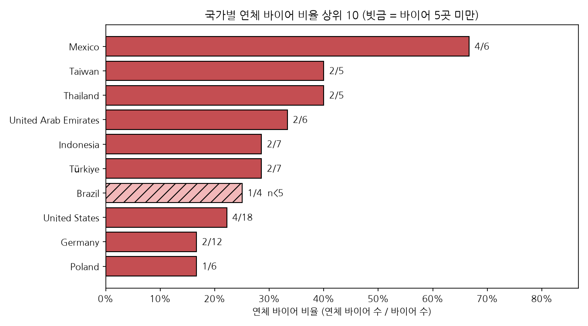
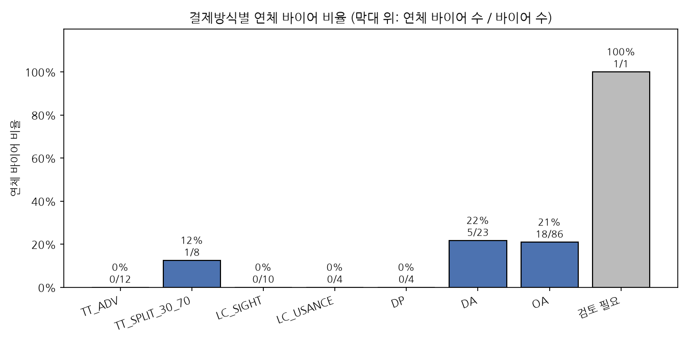

# 1일차 EDA 노트 — 바이어 연체 현황

- 노트북: `workbench/day1/notebooks/d1_eda.ipynb` (커널 재시작 후 전체 실행 완료)
- 정리 규칙: `scripts/d1_clean_rules.py` · 실행: `uv run python scripts/run_nb_upto.py workbench/day1/notebooks/d1_eda.ipynb all`
- 원본: `data/day1/d1_buyers_raw.xlsx`(읽기만) · 결제방식 코드: `workbench/day1/outputs/d1_code_table.csv`(TT = TT_ADV 사람 판단 반영)
- **연체 바이어 = `max_dpd_days > 0`** · 기준일 2026-09-30

## 분석 대상

| 단계 | 행 수 | 비고 |
|---|---|---|
| 원본 | 153 | |
| 완전 중복 삭제 | −1 | B047 |
| buyer_id 중복(첫 행 유지) | −2 | B094 · B114 (상호 표기만 다름) |
| 분석 표 | 150 | |
| dpd 확인필요 제외 | −2 | B058(`-`) · B066(`확인중`) — 연체 여부를 알 수 없어 비율 분모에서 뺌 |
| **연체 판단 대상** | **148** | 연체 바이어 25곳(16.9%) |

## 차트 1 — max_dpd_days 분포 (`charts/dpd_hist.png`)

1. 연체 여부를 판단할 수 있는 148곳 중 123곳(83.1%)은 연체 0일이고, 연체 바이어(dpd > 0)는 25곳(16.9%)이다.
2. 연체 25곳 중 12곳은 1~30일의 짧은 지연이지만 꼬리가 길어 평균 81.0일이 중앙값 31.0일보다 훨씬 크다(구간별 1-30: 12 · 31-60: 4 · 61-90: 5 · 91+: 4).
3. 91일 이상 4곳(B147 Thailand 381 · B044 Thailand 355 · B083 United States 305 · B071 Taiwan 269)은 사전상 채무불이행 추정 구간이라 우선 확인 대상이다. dpd가 `-` · `확인중`인 2곳(B058 · B066)은 그림에서 빠졌으므로 '확인 필요'.

## 차트 2 — 국가별 연체 바이어 비율 상위 10 (`charts/country_overdue_top10.png`)

1. Mexico가 6곳 중 4곳(66.7%)으로 가장 높고, Taiwan · Thailand 40.0%(각 2/5), United Arab Emirates 33.3%(2/6)가 뒤따른다.
2. 국가별 바이어가 3~18곳뿐이라 1곳 차이로 비율이 크게 움직인다(Brazil 1/4 = 25.0%는 5곳 미만). 비율은 22.2%지만 연체 바이어 수는 4곳으로 Mexico와 같은 United States처럼, 비율과 건수를 함께 봐야 한다.
3. 같은 40%라도 Thailand는 연체 2곳이 모두 91일 이상(B044 355일 · B147 381일)이고, Taiwan은 2곳 중 1곳이 269일(B071)이다. 따라서 국가 비교는 연체 비율만이 아니라 연체 깊이(dpd)와 함께 해야 한다.

## 차트 3 — 결제방식별 연체 바이어 비율 (`charts/paymethod_overdue.png`)

1. 외상 조건인 DA(21.7%, 5/23)와 OA(20.9%, 18/86)에서 연체 바이어 25곳 중 23곳이 나왔다. OA는 바이어 수도 86곳으로 가장 많아 연체 관리의 중심이다.
2. TT_ADV(0/12) · LC_SIGHT(0/10) · LC_USANCE(0/4) · DP(0/4)는 연체가 0곳이다. 다만 각 4~12곳으로 적어 "이 방식은 연체가 없다"고 일반화하기는 어렵다.
3. TT_SPLIT_30_70의 연체 1곳은 B087(Taiwan, 32일)이다. `검토 필요` 1곳(B085 United Arab Emirates, `10% T/T advance + 90% O/A 90 days`, 22일)은 1/1이라 비율 100%에 의미가 없고, 코드가 정해지면 다시 계산해야 한다.

### 결제방식별 바이어 수 · 연체 바이어 수 · 연체 바이어 비율

연체 바이어 비율 = 연체 바이어 수 ÷ 바이어 수. 연체 판단 대상 148곳 기준이며, 노트북 셀 ④의 출력을 그대로 옮겼습니다.

| 결제방식 | 바이어 수 | 연체 바이어 수 | 연체 바이어 비율 |
|---|---|---|---|
| TT_ADV | 12 | 0 | 0.0% |
| TT_SPLIT_30_70 | 8 | 1 | 12.5% |
| LC_SIGHT | 10 | 0 | 0.0% |
| LC_USANCE | 4 | 0 | 0.0% |
| DP | 4 | 0 | 0.0% |
| DA | 23 | 5 | 21.7% |
| OA | 86 | 18 | 20.9% |
| 검토 필요 | 1 | 1 | 100.0% |
| 합계 | 148 | 25 | 16.9% |

## 남은 확인 사항

- B094 · B114 중복은 처음 나온 행을 남겼습니다. 담당자 확인 결과에 따라 바뀔 수 있습니다.
- B058 · B066의 실제 연체일수, B085의 결제방식 코드를 확인해야 합니다.
- LC_USANCE 4곳 중 `L/C 60 days` · `L/C 90 days` 표기는 코드표에서 확신 낮음입니다.
